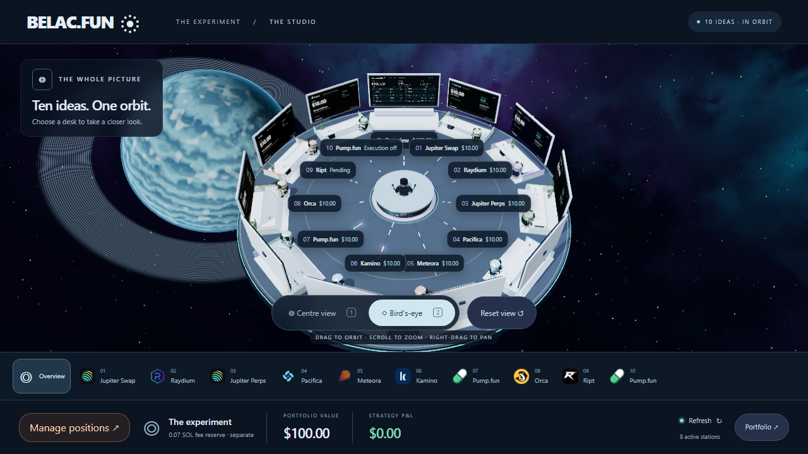

<div align="center">
  <picture>
    <source media="(prefers-color-scheme: dark)" srcset="docs/images/belac-mark-dark.svg">
    <source media="(prefers-color-scheme: light)" srcset="docs/images/belac-mark-light.svg">
    
  </picture>

  <h1>BELAC.FUN</h1>
  <p><strong>Ten ideas. One orbit. A $100 experiment on Solana.</strong></p>
  <p>Follow real positions, explore different strategies, and see what happens to the same small starting budget.</p>
  <p><a href="https://belac.fun/station"><strong>Enter the studio →</strong></a> · <a href="#the-ten-stations">Explore the stations</a> · <a href="#how-to-read-the-numbers">Understand the numbers</a></p>
</div>

[](https://belac.fun/station)

<p align="center"><sub>Studio interface preview. Open the live studio for current balances, returns, and position status.</sub></p>

## What is Belac.fun?

Belac.fun is a public record of one person's crypto experiment: start with **$100**, divide it into ten planned **$10 allocations**, and follow how different approaches behave over time.

Instead of a wall of trading charts, you explore a space studio. Each desk represents a strategy. The centre screen brings the whole experiment together, while the individual screens show position values and profit or loss.

The code is public so you can look behind the screens, understand the calculations, and follow how the project is built. You can watch without connecting a wallet or spending anything.

## Start exploring

1. **[Open the studio](https://belac.fun/station).** Start at the overview to see the experiment as a whole.
2. **Choose a station.** Use the numbered station buttons to inspect an individual strategy.
3. **Try Bird’s-eye view.** Orbit the platform and see how the desks connect to the central operator.
4. **Open Portfolio.** Compare the allocations and look at the details behind each position.

You don't need to know how to trade to follow along. Start with the station descriptions below, then use the numbers to see how each idea is doing.

## The ten stations

**The current run has eight funded stations.** Together they use $80 of the starting capital. Another $10 is reserved for a manual Ript pack opening, and $10 is reserved for the token-creation idea, which is excluded from this run.

| Station | Platform          | The idea, in plain English                                                              |
| :------ | :---------------- | :-------------------------------------------------------------------------------------- |
| 01      | **Jupiter Swap**  | Buy SOL and hold it to follow changes in its price.                                     |
| 02      | **Raydium**       | Track a separate SOL position for the active spot-trading experiment.                   |
| 03      | **Jupiter Perps** | A leveraged SOL long: a position that benefits when SOL rises, with amplified exposure. |
| 04      | **Pacifica**      | An ETH short: a position that benefits when ETH falls, with amplified exposure.         |
| 05      | **Meteora**       | Supply SOL and USDC to a trading pool and track the position plus fees earned.          |
| 06      | **Kamino**        | Lend USDC and track the interest it earns over time.                                    |
| 07      | **Pump.fun**      | Hold an existing memecoin, CATE, and follow its changing value.                         |
| 08      | **Orca**          | Supply SOL and USDC within a chosen price range and track the position plus fees.       |
| 09      | **Ript**          | A planned manual pack-opening experiment. Its $10 is reserved.                          |
| 10      | **Pump.fun**      | The original idea to create a token. Excluded from this run; its $10 stays reserved.    |

The long and short target a maximum of 2× leverage at entry and include protective stops. A stop targets an exit; it does not guarantee the eventual loss.

## How to read the numbers

- **Portfolio value** combines the tracked strategies and the experiment's unallocated USDC.
- **P&L** means profit and loss: the change from the starting allocation. An open position's value can change before it is sold or closed.
- **SOL fee reserve** is a separate operating budget. The initial 0.1 SOL pays network fees and account setup costs; it is excluded from the $100 strategy return.
- **Updating** means a data source is catching up or temporarily unavailable. The interface keeps the last verified values visible where available.
- **Closed** describes a settled position. Where settlement can be verified, its proceeds and realized P&L remain assigned to that strategy.

Values come from blockchain reads and supported platform APIs, linked back to the experiment's recorded entries. They are estimates until a position is settled, and they depend on the source, pricing method, and freshness shown in the details. Extra deposits are kept separate from strategy returns.

## Why build this in public?

The interesting part is following the whole process: what each strategy does, what it costs to use, how its value changes, and what can be verified afterwards.

Belac.fun makes that process visible through a shared starting budget, a readable portfolio, and public code. The studio is the front door; the implementation and documentation are here when you want to go deeper.

This is an experiment with real funds, not a recommendation to copy the positions or a promise of returns. Leveraged trades, liquidity pools, lending, memecoins, and pack openings carry different risks, including losing an allocation. Position changes require the owner's wallet approval; automated execution is disabled.

## Questions, ideas, or something broken?

[Open an issue](https://github.com/Belacosaur/belac-fun/issues) with what you noticed or what you would like explained. For a visual issue, include the station, device or browser, and a screenshot if possible. Never include private keys, seed phrases, passwords, or access tokens.

Clearer explanations, accessibility improvements, and reproducible bug reports are welcome. For a substantial code change, start with an issue so we can agree on the direction.

## For builders

The frontend uses **React, TypeScript, Vite, and Three.js**, hosted on **Cloudflare Pages**. The **Node.js/Fastify API**, background workers, and **PostgreSQL database** run on **AWS**. The public API is at `https://api.belac.fun`.

<details>
<summary><strong>Run the studio locally</strong></summary>

Requires Node.js 22+ and pnpm 10.18.2.

```sh
corepack enable
pnpm install --frozen-lockfile
pnpm --filter @belac/web dev --host 127.0.0.1
```

Open `http://127.0.0.1:5173/station`. The studio's read-only feed defaults to the public AWS API. To use another backend, set `VITE_API_BASE_URL` in a local environment file; keep credentials out of all `VITE_*` variables because those values are public in the browser.

This starts the frontend. Running the backend or database locally requires separate configuration; use `.env.example` as a variable reference and `docker-compose.yml` for the local development database. Production uses AWS, not the older Railway setup described in historical notes.

</details>

<details>
<summary><strong>Checks and project structure</strong></summary>

```sh
pnpm typecheck
pnpm lint
pnpm test
pnpm --filter @belac/web build
pnpm --filter @belac/web e2e
```

Database integration tests require Docker. Browser tests use Playwright and may need its browser dependencies installed.

| Directory   | What lives here                                                               |
| :---------- | :---------------------------------------------------------------------------- |
| `apps/web`  | The studio, public pages, and owner review interface.                         |
| `apps/api`  | Public data endpoints and authenticated owner/admin routes.                   |
| `apps/jobs` | Position reads, reconciliation, research, and background workers.             |
| `packages`  | Shared contracts, database schema, configuration, and financial calculations. |
| `docs`      | Design notes, implementation records, and operational guides.                 |

Keep wallet keys and import files in ignored `.secrets/`, and generated reports or database exports in ignored `artifacts/`. Neither belongs in Git or deployment uploads. Server-side signing and automated execution remain disabled.

</details>

### Explore the implementation

- [Architecture](architecture.md) — the original system and accounting design.
- [Studio and product design](uiux_design.md) — the original experience specification.
- [Wallet approval design](docs/design/wallet-execution-architecture.md) — how owner reviews and wallet signatures are separated from the server.
- [Accounting rules](packages/finance/src) — the financial calculation code.
- [Shared station definitions](packages/contracts/src/challenge.ts) — the ten strategy identities used throughout the app.

Design and integration documents include historical plans. Some refer to earlier infrastructure or earlier runs; the live studio is the place to check current position status.

---

<p align="center"><strong>Follow the experiment. Understand the numbers.</strong><br><a href="https://belac.fun/station">belac.fun/station</a></p>
