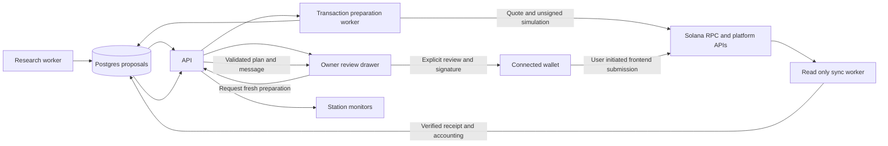

# Wallet approved strategy execution architecture

## Purpose and proposed approach

Belac.fun automatically researches opportunities, prepares bounded strategy proposals, builds and simulates transactions, reconciles confirmed activity, and tracks performance. The owner connects the challenge wallet to the frontend and explicitly reviews, signs and submits each financial action. Scheduled workers never hold the spending key or trigger a live investment.

Keep the existing Railway project and five services. Evolve the idle execution-worker into a transaction preparation worker; keep signing and submission in the owner's wallet/frontend. This is a proposed design, not an implemented execution flow. No production settings or existing positions change as part of this design.

The alternative of a backend custodial signer adds key custody and unattended execution authority that this frontend approval workflow does not need. A separate service for every platform would duplicate queues, persistence and reconciliation; use a shared adapter contract within the preparation worker instead.

## Service responsibilities

| Component | Responsibility | Authority |
|---|---|---|
| Research worker | Scheduled data collection, screening, weekly proposals, exit/rebalance suggestions | Read market and wallet data; create proposals |
| API | Public studio feed; authenticated owner sessions; proposal review, preparation jobs and attempt registration | Enforce wallet binding, policy and job permissions; never sign or submit |
| Transaction preparation worker | Current quote, validated instructions, complete message construction, simulation, cost summary | Build unsigned messages; no spending keys, broadcast methods or signed transaction ingestion |
| Sync worker | Watch registered signatures, recover interrupted attempts, verify receipts and ownership, mark positions | Read chain; write verified accounting and screen snapshots |
| Postgres | Proposals, policies, jobs, reservations, attempts, receipts, ledger and snapshots | Durable coordination and audit history |
| Frontend and wallet | Connect, review, request a fresh plan, sign and submit through a user action | Owner's wallet grants the specific transaction signature |

The frontend uses Solana Wallet Standard capabilities. The preferred path is signTransaction followed by browser-side submission, allowing the signature to be recorded before broadcast. Wallets that only offer signAndSendTransaction need a separate tested recovery path; unsupported capabilities produce a clear message, not an unsafe fallback.

Public visitors continue to see the current studio. Proposal preparation and transaction controls are owner-only, in an authenticated review drawer opened from the relevant monitor. Public viewers cannot reserve capital or enqueue transaction jobs.

## End to end flow

1. Research produces a versioned proposal with station, action, rationale, evidence timestamps, market/pool, policy and principal ceiling. A valid outcome is no suitable trade. Ript remains pending until its product is ready.
2. The owner connects the challenge wallet and authenticates. The frontend presents the proposal without treating it as an investment or allocated capital.
3. On Prepare, the API acquires a capital reservation and creates a bounded job. The browser generates any required new position mint keypair locally and supplies only its public key to the builder.
4. The worker refreshes balances, ownership, pool state, quote and blockhash. It builds allowed instructions, resolves address lookup tables, verifies the full message, simulates, and records a deterministic review summary tied to the message hash.
5. The frontend displays maximum principal debit, minimum output, proposed inventory, slippage, network/priority fee cap, rent, residual balances, pool/range, expiry and expected account changes. It independently checks the returned message against the allowed plan before requesting a signature.
6. An explicit Sign and execute action opens the owner's wallet. Extra account signatures are added locally without changing the reviewed message. No wallet spending key or mint private key is sent to the API.
7. The frontend records the transaction signature and attempt before submitting the exact signed bytes through its configured RPC path. This attempt registration is not proof that the transaction was broadcast or succeeded. If registration fails, do not proceed with this preferred submission path.
8. Sync verifies the actual transaction, expected message hash, signer wallet, programs, account changes, token debits/credits, fees and position identity. Confirmed status can show Opening; finalized and fully reconciled receipts become Active and update allocations and P&L.
9. Subsequent research can propose an exit, claim or rebalance. Each new financial transaction repeats the same review/signing flow; a wallet connection or login signature grants no standing trading authority.

## Wallet ownership and position mint signatures

The experiment currently owns its positions under `HBFn6VWPLNt44i8zqUoNs4mMtqyyxNTyWwQqfH5TBx8j`. Connecting a different address does not grant control over those positions. Version one should require this address for execution and display other connections as a wallet mismatch.

The owner can import the existing keypair into their wallet using the wallet's own trusted import flow. The Belac frontend must never ask for a seed phrase, upload a keypair or receive a private key. A different long-term wallet requires a separately planned migration; some position assets or authorities may need platform-specific handling. Do not silently move funds or NFTs.

Meteora and some Orca position openings need a fresh mint account signature as well as the owner's spending signature. Generate that auxiliary keypair in browser memory, pass its public key during preparation, and apply its signature locally to the exact reviewed message. It cannot spend the owner's funds on its own. The owner wallet signature is always required. Verify that supported wallets preserve and accept the additional signature; test the actual ordering for each wallet. The current hash-derived simulation mint placeholders are not usable real mint keypairs.

If the page closes before signing, abandon that preparation after resolving whether anything was submitted. If it closes after submission, the sync worker uses the registered signature and expected position addresses to reconcile; it does not need the auxiliary mint private key to value or withdraw a normal created position.

## Durable proposals and expiring transaction attempts

Separate a long-lived research proposal from short-lived prepared messages. Each refresh creates a new immutable attempt; it never mutates a previously signed message. Research timestamps, quote expiry, application TTL, blockhash and lastValidBlockHeight are distinct fields. Use the earliest applicable expiry. Expired quotes require a rebuilt message, a new simulation and a new user review; changing the blockhash invalidates prior signatures.

Suggested proposal states: draft, researched, eligible, blocked, completed, cancelled. Attempt states: queued, preparing, ready, rejected, expired, awaiting_submission, submitted, confirmed, finalized, reconciled, failed and unknown. The display may simplify these to Ready for review, Awaiting signature, Opening, Active and Needs attention.

Use database transitions with compare-and-swap version checks. Workers claim bounded jobs using leases and SKIP LOCKED; expired job leases are recoverable. Lock reservations per wallet and station/action to prevent simultaneous attempts exceeding the same allocation. A replacement attempt must supersede an unsigned predecessor. Do not release submitted or unknown reservations merely because a UI timer expires.

Timeouts are unknown, not automatically failures. The sync worker checks signature status and transaction history, as well as expected created accounts and balance changes when necessary. It must resolve an old signed attempt before allowing a conflicting replacement. Re-sending identical signed bytes differs from signing a fresh transaction; never automatically rebuild an investment because an RPC timed out.

Prefer one atomic transaction for acquisition plus deposit. If an adapter needs several transactions, represent a persisted multi-step plan with a total budget and a separate user signature for each step. Reconcile each completed step before preparing the next. If a later step fails, show intermediate token holdings and a recovery proposal; do not perform an automatic compensating trade.

## Adapter contract and validation

Each platform adapter implements discover/read, quote, buildEntry, buildExit, simulate, decodeReceipt and valuePosition. Optional capabilities include claim, rebalance and launch. An adapter reports unsupported operations explicitly. Return a transaction plan with steps, required signers, expected accounts, instruction semantics, expected balance changes, bounded costs and validation evidence. Value functions operate on attributed inventory, not the whole wallet.

Build-time policy must validate cluster, wallet, station and action, approved program IDs, instruction discriminators/arguments, token mints, pool/vault identities, token programs/extensions, fee payer, all required signers, token destinations and recipients of reclaimed rent. Resolve lookup tables before validating accounts. Bound input amount, output minimum, slippage, priority fees, rent and any approvals/delegates. Reject unknown instructions and unexpected native SOL principal debits. Validate quote bytes rather than trusting an upstream human-readable label.

Simulation must cover the exact executable message being offered, including the actual new mint public key and fee settings. Zero signatures are allowed for simulation only; these results are never reported as ownership or a filled trade. The frontend verifies that the returned message and decoded summary agree, and that signing does not change its message. Simulation success cannot guarantee landing or future exit liquidity.

This shared interface starts with Meteora DAMM v2, then moves the existing Jupiter spot, Orca and Kamino logic out of one-off scripts. Raydium, Jupiter Perps, Pacifica and Pump.fun follow only after their adapters meet the same readiness checks. Ript stays pending. Do not infer support for an action from general platform API availability.

## Capital and performance ledger

Use one wallet with separate accounting buckets, matching the current experiment:

- 100 USDC strategy capital, ten 10-USDC station allocations; reserve a station's full available allocation while preparing it.
- Native SOL buy-and-hold position inventory, protected from gas use.
- SOL operating funds for network fees and account rent.
- Each strategy's residual USDC and WSOL, attributed from its own transaction deltas.
- Unallocated capital, unmatched incoming funds and unreconciled changes.

This is accounting separation in a shared wallet, not separate on-chain vaults. Every prepared message must preserve protected holdings and the minimum operating balance. Principal SOL is acquired using the station's own budget. It must not consume the gas pool or Orca's residual WSOL. A distinct on-chain fee wallet would require sponsorship/extra signers and is not needed for version one.

Record allocation, fill cost, position inventory, attributed residual cash, accrued fees and realized cash flows independently. Strategy equity includes its position plus attributed residuals, without counting them twice as unallocated wallet cash. Rent is recoverable account capital; its return goes back to the operating bucket rather than appearing as strategy profit. Actual network/priority fees, including charged fees on failed transactions, are recorded separately. The dashboard can show strategy P&L, fees and net experiment performance without mixing them.

Replace hardcoded active-entry constants with immutable verified database receipts and position records. Backfill the three existing finalized entries, compare database-derived totals against the current implementation, and switch readers only when attribution reconciles. A prepared proposal never increments the live-position count or reduces actual unallocated capital. Reservations affect available-to-prepare funds, not settled balances.

## Persistence and API boundaries

Reuse research_runs and research_observations. Add:

| Records | Main fields and constraints |
|---|---|
| strategy_proposals | wallet, station, action, evidence/run reference, policy version, budget, status and revision |
| preparation_jobs | proposal/attempt, bounded input, lease owner/expiry, retry count; no signing job type |
| transaction_attempts | proposal, revision, message hash/bytes, blockhash, last valid height, quote limits, simulation, expected accounts, state and signature |
| capital_reservations | wallet, station, amount and bucket, active attempt; release only through verified transitions |
| execution_receipts and positions | immutable finalized chain evidence, exact costs, ownership and platform identifiers; unique chain/signature with per-instruction events |
| ledger_events | idempotent inventory movements, residuals, fees, rent and realized returns linked to verified chain events |

Proposed owner routes: wallet challenge/session, list proposals, request preparation, read preparation status, register attempt signature, and request cancellation of an unsigned attempt. Public routes expose sanitized station/accounting snapshots only. No server /execute, /sign or /broadcast endpoint in this architecture, and no signed transaction blob accepted by the API. Store unsigned evidence and signatures, not reusable spending authority.

Wallet login uses a one-time, expiring, domain- and chain-bound challenge, with nonce consumption and an address allowlist. Use a signed-message/sign-in capability supported by the wallet. Owner/admin authentication alone is not proof of wallet ownership. Apply CSRF protection, strict origins, secure sessions, request limits and authorization to every preparation and reservation endpoint.

Postgres is sufficient for the initial queue; no extra Redis service is necessary. Keep preparation worker concurrency low, with per-source timeouts and retry limits. Background jobs can automatically recover read/build/simulation failures, but never sign or submit financial actions.

## Release boundaries and acceptance

Use explicit capability names such as preparationEnabled, walletSigningRequired, serverSigningEnabled=false and serverBroadcastEnabled=false. Replace the old execution-worker's invitation to provision a spending key with the new preparation-only capabilities. Never repurpose a single executionEnabled flag to mean both safe preparation and spending authority.

First deliver wallet ownership/authentication, the proposal/attempt/reservation schema and a Meteora review drawer. Next build fresh unsigned entry/exit plans and browser auxiliary signing. Then implement signature recovery, finalized receipt ingestion and database-based Meteora tracking. Migrate the three current readers after reconciliation. Add the remaining adapters and recurring research proposals incrementally.

Acceptance cases include: wrong wallet cannot prepare; expired plan cannot be signed through the app; modified message or extra signer is rejected; combined Meteora principal debit cannot exceed 10 USDC; gas/hold/Orca residuals remain protected; duplicate clicks and worker restarts cannot create conflicting attempts; browser/RPC interruptions recover without duplicate entries; failed-transaction fees are tracked; finalized receipts update the screen exactly once; research and preparation never invoke signing or broadcast; Ript remains pending.

The first live end-to-end acceptance is performed by the owner through their wallet. Before then, tests use fixtures, mocks and supported test environments, plus unsigned mainnet simulation where required. No live financial action is part of design or development verification.

## Technical references

- [Solana transaction lifecycle](https://solana.com/docs/core/transactions): messages, signatures and atomic processing.
- [Solana confirmation and expiration](https://solana.com/developers/cookbook/transactions/confirmation): blockhash lifetime and confirmation recovery.
- [Wallet Standard example](https://github.com/wallet-standard/wallet-standard/blob/master/packages/example/wallets/src/solanaWallet.ts): capability-based wallet connection/signing.
- [Official Meteora DAMM v2 IDL](https://github.com/MeteoraAg/damm-v2-sdk/blob/main/src/idl/cp_amm.json): actual instruction accounts and required signers.
